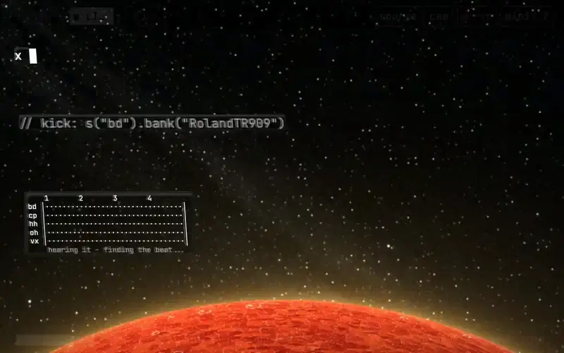
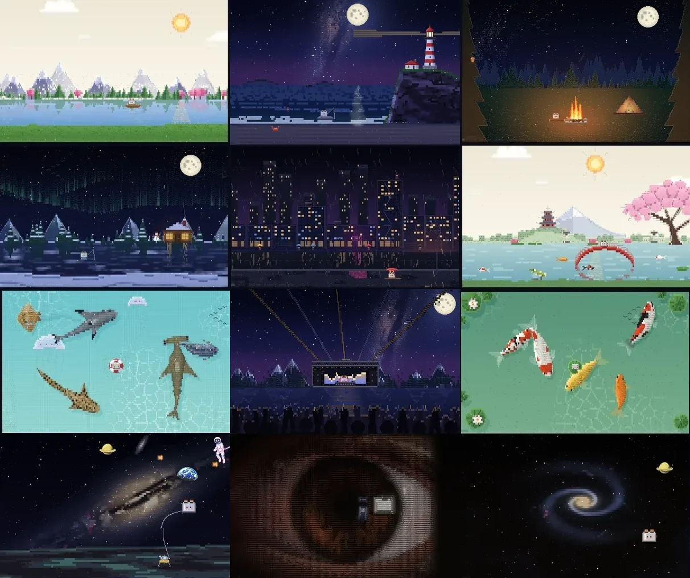
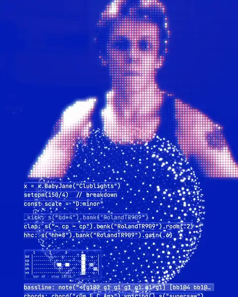
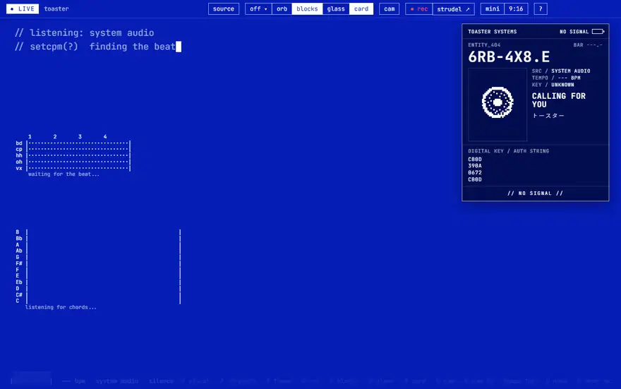

# Toaster

Toaster hears whatever is playing on your Mac or PC (Spotify, YouTube, anything) and writes it out as live
[Strudel](https://strudel.cc) code in front of you: named lines typed into a blank window, lighting up as they play.
Around the code, the song plays out as dominoes, little worlds, a handheld rhythm game, or your own webcam, worked with
your hands. Toaster, as in Toaster Strudel.

**[Try it in your browser](https://toaster.locust.lol)** · **[Download for Windows or Mac](../../releases/latest)**



**How it works:** Toaster listens to whatever your computer is playing and picks the song apart by ear, the way a
drummer would. It catches every hit and sorts it: a low thump is the kick, a snap is the clap, a tick is the hi-hat.
From where the hits land it finds the tempo and the bar lines, and from the low notes and the harmony it works out the
bass line, the chords and the key. Everything it's sure of gets typed in as a line of Strudel code that lights up as it
plays, and it keeps rewriting as the song moves. No AI, just listening. It's a live sketch of the song, not a perfect copy.

## Start here

1. **Play the demo.** Open [toaster.locust.lol](https://toaster.locust.lol) and press *hear it on a demo song*: no mic,
   no account. The code types itself as the beat plays.
2. **Pick a look.** Press **V** (or the background button) for the scenes, the worlds, the Earth and the rest, or one of
   the presets along the picker's top for a whole look in one click.
3. **Use your own music.** In the browser: a tab's sound, your mic, an audio file or a radio stream (**S**). In the app:
   anything playing on your computer, straight away.

Lost? **?** lists every key, and **Ctrl+K** finds any command by name.

## What it does

- **Writes the song as code you can play.** A line for each part, typed the way a live coder performs it
  ([what you'll see in the code](#what-youll-see-in-the-code)). It's real Strudel: in the app, **Shift+O** opens the
  live code in strudel.cc, ready to play and change.
- **Rebuilds the song from its own sounds.** In the app, press **X** and Toaster takes the song apart on your own
  computer (drums, bass, voice and the rest, with Meta's open-source Demucs model) and saves it as code that plays the
  song's own sounds; **O** opens it in strudel.cc (rebuilding it first if you haven't pressed X). The drums and the bass
  are written out as notes (the bass is the roughest part); the voice and the keys are the record's own pieces, replayed.
- **Your camera, worked with your hands.** Frame something with your fingers, open a portal with a circle of them, change
  the theme with a ✌️. [More below](#your-hands-in-the-picture).
- **Visuals that move with the song.** Eleven little scenes that answer the drop, planets cut on the kick, the Earth in
  NASA's own footage from the space station, liquid chrome, the backrooms, dominoes, a handheld rhythm game and more.
- **Remembers what it has heard.** The second play of a song locks faster, and it reads the songs in your music folder
  ahead.
- **Plays well with Spotify.** It hears Spotify like any other app. Connect your own account (a free Spotify developer
  app of your own, and Premium) to browse, search and play inside Toaster ([how](docs/spotify.md)).



## Your hands, in the picture



Press **C** for the camera, and Toaster watches your hands (with Google's MediaPipe, on your machine).

- **The finger frame.** Make an L with each hand and a window opens between your fingertips, showing what's inside
  through one of 16 filters. Turn a hand over and the card twists round to its back; flick it, bunch your fingertips
  together or wink for the next filter.
- **Portals.** Make a circle with your hands and hold it: a round window opens on a look inside, your own skull in X-ray
  first, then x-ray, glass, a kaleidoscope, a time tunnel and more. Pull your hands apart and it grows; spread them wide and it
  fills the picture, with you cut out in front of it.
- **Hand signs.** ✌️ for the next theme, 👍 to start or stop recording, ✊ to hush, 🖐 to come back.
- **Camera effects.** **K** cuts you out over the visuals, or turns you into dots, voxels or glass.

Keep your hands a little inside the edges of the picture: the tracker loses a hand that's half out of it.

<br clear="right">

## Get it

Windows 10 or 11, or macOS 13 or later. A webcam is optional.

**Windows.** Download `Toaster-<version>-win-x64.zip` from the [Releases](../../releases) page, unzip it anywhere and
double-click `Toaster.exe`. The first time, Windows may say "Windows protected your PC" (the app isn't signed): click
**More info**, then **Run anyway**. It starts listening straight away.

**Mac.** Download `Toaster-<version>-mac-universal.zip` from the [Releases](../../releases) page (one app for Intel and
Apple silicon), unzip it and drag Toaster into Applications. It isn't signed by Apple, so the first time the Mac won't
open it: open **System Settings → Privacy & Security**, scroll down to Toaster and click **Open Anyway**. It asks to
record system audio: allow it. That's how Toaster hears what's playing; it doesn't record the screen, and the camera
stays off until you press C.

Play some music: within a few seconds it finds the beat and starts typing.

**Updates.** When a newer Toaster is out, it offers it a few seconds after it starts. Say yes and it downloads it, checks
it against the checksum GitHub lists for it, and opens again as the new version (your settings stay). On a Mac it has to
be in Applications to replace itself. If an update doesn't go through, the old copy stays as it was and Toaster says
why. You can turn the check off in the help (**?**). To hear about new versions here too, use **Watch → Custom →
Releases** on this page.

## Keys

Every key can be changed in the help (**?**). The help also has **report a bug**: Toaster writes a GitHub issue for you
to read, edit and send yourself. The full detail of every key and every background is in
[docs/keys-and-looks.md](docs/keys-and-looks.md).

| Key | Does |
| --- | --- |
| S | audio source: system audio, demo beat, file, input, radio |
| V | background: scenes, worlds, the Earth, the backrooms, chrome, spaghetti, spectrogram, lanes, cuts, fire, the code rain, off |
| A | the next one of whatever's showing: the scene, the worlds' look, the Earth's view, the handheld's screen |
| P | code look: dominoes, the handheld rhythm game, punchcard, none |
| R | over the picture: the orb, the glass blob, both, none |
| C | camera: behind the code, big eyes, ASCII, off |
| K | camera effect: cut-out, slit-scan, datamosh, windows, glass, dots, voxels |
| D | the drop, now |
| B | drop effect: XP takeover, the y2k bug, blue screen, not responding, off |
| T | theme: bluescreen, blackscreen, terminal, pink, whitescreen, dynamic (the cover's colours), softclub, fall2003 |
| U | a look over everything: trails, dots, LED, halftone, VHS, line art, four glass looks |
| Y | an old CRT TV over everything |
| Z | hide the code, for a visualizer; again for the code without its beat |
| G | the library: your music, Spotify, the radio, saved scenes |
| N | now-playing ID card |
| L | vertical 9:16 layout for TikTok, Shorts and Reels |
| W | mini player, on top of everything else |
| H / F | hide the header and footer / fullscreen |
| Space | tap the beat, for a song it can't find the beat of |
| Q | hush every part (the sound keeps playing) |
| E | name the song yourself |
| I | machine readout |
| [ / ] | fine-tune the sync, 10 ms a press |
| M | record a video |
| J | drop clips: save each song's first two drops as videos |
| X | save the song: rebuilt from its own sounds, plus a MIDI file and Strudel code |
| O | hear the rebuilt song in strudel.cc |
| Shift+O | open the live code in strudel.cc |
| Ctrl+K | everything by name |

The looks you pick, the keys and the radio's address are remembered between launches; the camera always starts off.

## What you'll see in the code



The code is typed the way a live coder performs it: a part that stops gets a `_` in front of its name (Strudel's mute)
and loses it when it comes back, a part never heard yet stays a comment, and a change lands on the next bar line, the way
ctrl+enter on the downbeat does. Now and then a closing bracket gets left out: a red error shows, then the caret goes back
to fix it.

- The filters sit on sliders, `.lpf(slider(850, 100, 4000))`, and when the music's filter moves, the number slides
  there instead of being retyped, like dragging the slider.
- A bass whose filter sweeps on the 8ths, triplets or 16ths (dubstep's wobble, riddim's pulse) gets Strudel's filter
  LFO, locked to the bar: `.lpsync(8).lpdepth(3)`.
- When the chords pump under the kick (sidechain, in most house and EDM), the kick gets `.duck("2:3").duckdepth(.6)` and
  the bass line and chords go on orbits 2 and 3, the way you'd set that up in Strudel.
- The tempo line says `// breakdown` while the kick is out for a bar or more, and `// drop` for the first 4 bars after
  a drop.
- Half-time music (dubstep, much of trap) is written the way its producer would: the kick on 1 and the clap on 3. A slow
  song heard at double its tempo goes back to its own tempo.

## Saving things

- **M** records the window with its sound into `Videos\Toaster` on Windows, or `Movies/Toaster` on a Mac, as an MP4
  ready for TikTok, Shorts and Reels. Switch to the vertical layout (**L**) first for a 1080 x 1920 video.
- **J** turns on drop clips: the first two drops of each song are saved as their own videos (the build-up and the drop)
  into that same folder.
- **X** saves the song into `Music\Toaster` on Windows, or `Music/Toaster` on a Mac, as one folder for the song. At its
  top, `rebuilt.wav` is what the rebuilt song sounds like, and `song.strudel.js` is that song as code, with the sounds it
  plays (cut from the song). A subfolder, `notes (stand-in sounds)`, holds Toaster's notes: a MIDI file (drums, bass,
  chords and lead on their own tracks) and Strudel code you can paste into strudel.cc, on stand-in drum-machine sounds.
  Each save is a new folder of about 6 MB. If the song can't be rebuilt, X still saves the notes and says why.
- **O** opens the rebuilt song in strudel.cc, with Toaster serving its sounds while it's open. On a Mac it needs Chrome
  or Edge (in Safari it stays silent). Chrome asks once whether strudel.cc may reach apps on your computer: allow it.

What it saves is an approximate sketch of the song you played, and the rebuilt song carries pieces of the recording
itself: whether you may publish either depends on the music and what you want to do with it.

More in [docs/how-it-works.md](docs/how-it-works.md). Filming Toaster for a video? [docs/creators.md](docs/creators.md)
has the setup, the take, and how to carry on in Strudel.

## For DJs and streamers

Toaster makes live visuals for a set: it follows the beat, and the scenes answer the drop.

1. **Let it hear the set.** On a Mac it hears everything the Mac plays, your DJ software too. With a mixer, pick its USB
   or line-in as the audio input (**S**).
2. **Set the look.** The *Visualizer* preset (the picker's first row, or Ctrl+K) shows the scenes with the code hidden;
   **Z** brings the code back. **V** picks the background, **T** the theme.
3. **Clear the frame.** **H** hides the header, the footer and the player bar; **F** goes fullscreen.
4. **The drop.** Toaster fires it by itself when the kick comes back after a break of three seconds or more; press **D**
   the moment it lands to fire it yourself, and **B** to pick a drop effect.
5. **Into OBS.** Add Toaster's window as a source: on a Mac, *macOS Screen Capture* with the window method; on Windows,
   *Window Capture* with the capture method *Windows 10 (1903 and up)*. Or press **M** to record the window with its sound.

## Questions

**Does it split the song into stems?** Not while it plays: live, it listens to the whole mix and picks out the kick,
snare, hats, bass and chords from their frequencies and timing, then writes them as code that plays on drum-machine
samples and synths. When you press X, yes: it takes the song apart into drums, bass, voice and the rest, on your machine.

**Will the code sound exactly like the song?** The live code doesn't: it's a sketch of the song's parts, and the sounds
are stand-ins. The rebuilt song (X) comes much closer on songs with a beat, because it plays the song's own drum hits,
its own bass and the singer's own phrases, placed by the code.

**What does it do best?** A steady beat. A song without clear drums can take 8 to 20 seconds to find one; tap Space on
the beat to give it the tempo. Its weak spot is the kick under a busy or sidechained bass, which is most modern dance
and pop: it can take bass notes for kicks. If a song reads wrong, the flag at the end of the site's player bar reports
it in one click. What it can and can't hear yet is at the end of [docs/how-it-works.md](docs/how-it-works.md).

**Where does the song's name come from?** The system's media controls (Windows' media controls, or the Mac's Now
Playing), so any player that shows up there works: Spotify, browsers and the rest.

**Radio?** **S** plays an internet radio stream whose address you paste in. Toaster comes with no stations, but
[docs/radio-stations.md](docs/radio-stations.md) lists a few that publish theirs.

**On a touch screen?** ☰ in the header opens every key as a button.

## Privacy

Everything Toaster hears and sees stays on your machine. The sound is worked out in the app, and the camera (off until
you press C) is looked at by the system's own face detector (Windows' face detector, or the Mac's Vision framework) and
by Google's MediaPipe, both running on your machine. Nothing is uploaded. For a saved song (X), the app keeps the last
ten minutes of what it heard in memory only, never in a file, and it is gone when you quit; when you press X, Spotify's
open-source Basic Pitch model listens to that stretch and Meta's open-source Demucs model takes it apart, both on your
machine. While Toaster is open it serves the rebuilt songs' sounds to strudel.cc from your own computer (`localhost`,
port 47283: only the `.wav` files and the `strudel.json` list at the top of a song's folder, and nothing outside your
computer can reach it). It goes online only for these:

- **Updates and stars:** GitHub, when it starts, to see whether there's a newer Toaster (turn that off in the help,
  under Updates), and for the project's star count on the header's star button (asked at most every ten minutes).
- **Strudel:** strudel.cc when you press O (your browser opens it with the code in the link).
- **The radio,** while it plays: its stream (from the server at the address you typed) and, for each song, the song's
  artist and title, sent to Apple's iTunes Search to find its cover; the cover is fetched from Apple's image server.
- **Spotify,** only if you connect your own account: the sign-in at accounts.spotify.com, then Spotify's Web API for
  your playlists, saved albums and liked songs, the songs and artists you search for, artist pages and releases, album
  details, the current song and its position and allowed controls while Spotify is the system player, and playing what
  you pick; covers come from Spotify's image servers. The sign-in's token stays in the app's main process, kept
  encrypted (with a key from your system's keychain) in Toaster's settings folder, and never reaches the page. Without a
  connection, a pasted Spotify link just opens in the Spotify app or Spotify's web player.
- **Spotify's embedded player,** when you choose **▶ preview**: the Spotify frame connects directly to Spotify and its
  media services. Spotify may use cookies and its own sign-in, separately from Toaster's optional library connection.
  Toaster does not pass that connection's tokens to the frame. Closing the player removes it.
- **The Earth and the backrooms:** the first time you pick one, its video (6 to 25 MB) downloads from
  toaster.locust.lol, is checked against its checksum and kept, so it doesn't download again.

Each of these carries what any web request carries: your IP address and the app's name and version.

The site, toaster.locust.lol, works the same way: your audio never leaves your device. The site counts visits
anonymously (Cloudflare Web Analytics, no cookies) and asks GitHub for the project's star count.

## Build it yourself

With Node.js (it's built with Node 24):

```
npm install
npm start          # run it
npm run dev        # run it with a debugging port (9333) for tools/cdp.mjs and tools/checks.js
npm run package    # build for the OS you're on: dist/Toaster-win32-x64, or dist/Toaster-darwin-universal
```

On a Mac, `npm start` compiles the Swift helpers (now playing, and faces) the first time, with Xcode's command line
tools. `npm run package:win` and `npm run package:mac` build the other OS's app; the Mac app has to be built on a Mac.
Each release's Mac app is built on GitHub's Macs (.github/workflows/mac.yml), signed ad hoc.

How it works inside, and the test songs it's checked against: [docs/how-it-works.md](docs/how-it-works.md).

## Built with Toaster

- **[golden](https://itsgolden.app)** by Jon Soini: a free iPhone player for Apple Music in Toaster's look, with its
  code view, ID cards and themes. Toaster's dynamic theme and its library (G) are after golden's.
- **Internet radio** by Jeffrey Li ([#6](../../pull/6), [#7](../../pull/7)): paste a stream's address and Toaster plays
  it and writes it out. He has also built a background of his own on top of Toaster.
- **A 3D-printed handheld** by Clemens ([@tokyo_impressions](https://www.instagram.com/tokyo_impressions)), printed from
  the game's model.

Made something with Toaster? Show it in [Discussions](../../discussions), or see [CONTRIBUTING.md](CONTRIBUTING.md) to
build on it.

## Credits and license

Toaster is MIT licensed ([LICENSE](LICENSE)). It uses Google's MediaPipe (Apache 2.0) for the camera;
[THIRD-PARTY-NOTICES.txt](THIRD-PARTY-NOTICES.txt) lists everything it uses and the artists whose looks it's after. The
code it writes is [Strudel](https://strudel.cc). Toaster is an independent project, not made by or affiliated with the
Strudel project.

If Toaster made you smile, a star helps more people find it.
